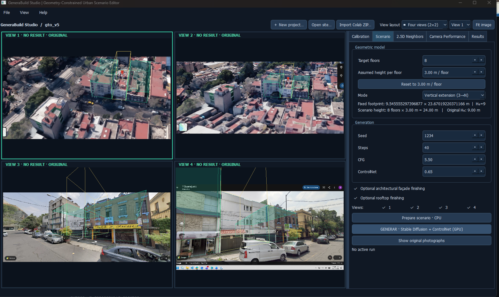
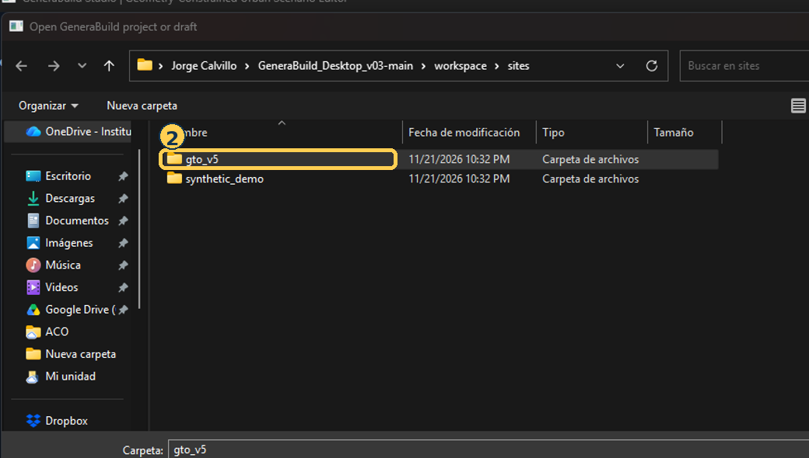
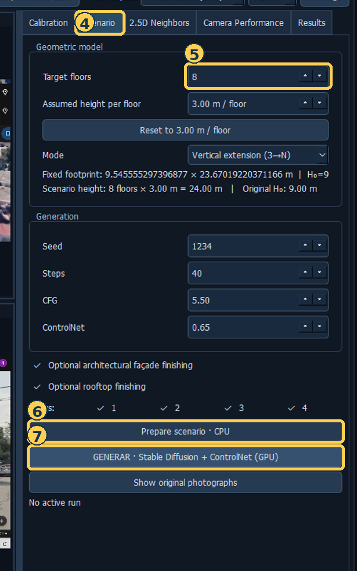

# GeneraBuild Studio

**Editor de escenarios urbanos con geometría 3D y generación condicionada mediante Stable Diffusion + ControlNet.**

Este repositorio contiene una demostración sobre **Guanajuato 8, colonia Roma Norte, Ciudad de México**. El proyecto permite visualizar una ampliación hipotética de un edificio existente de **3 a 8, 9 o 10 pisos en total**, conservando su huella y utilizando cuatro fotografías de referencia.



## 1. Instalación y ejecución

**Requisito:** Python 3 y un entorno capaz de instalar las dependencias declaradas en `requirements.txt`. Los comandos siguientes están escritos para **Ubuntu/Linux**.

### Opción A. Instalación desde el paquete ZIP

Si recibió el archivo `GeneraBuild_Desktop_v03_2_PhotoFirst_Complete.zip`, abra una terminal en la carpeta donde lo descargó y ejecute:

```bash
unzip GeneraBuild_Desktop_v03_2_PhotoFirst_Complete.zip
cd GeneraBuild_Desktop_v03_2_PhotoFirst
python3 -m venv .venv
source .venv/bin/activate
python -m pip install --upgrade pip
python -m pip install -r requirements.txt
python -m generabuild_desktop
```

> El nombre del directorio descomprimido debe coincidir con el contenido del ZIP. Si es distinto, ajuste el comando `cd`.

### Opción B. Instalación desde GitHub

Si ya clonó o descargó **este repositorio**, abra una terminal **en su carpeta raíz** (donde se encuentra `requirements.txt`). No necesita ejecutar `unzip`:

```bash
python3 -m venv .venv
source .venv/bin/activate
python -m pip install --upgrade pip
python -m pip install -r requirements.txt
python -m generabuild_desktop
```

### Dependencias para generar imágenes con GPU

Los comandos anteriores instalan la aplicación. **Para ejecutar la síntesis de nuevas imágenes** también se requiere PyTorch con soporte CUDA (si usa una GPU NVIDIA) y las dependencias adicionales del proyecto:

```bash
# Instale primero PyTorch con CUDA compatible con su equipo.
python -m pip install -r requirements-gpu.txt

# Verifique el reconocimiento de CUDA:
python -c "import torch; print('CUDA disponible:', torch.cuda.is_available())"
```

Si CUDA no está disponible, puede revisar configuraciones y resultados previamente guardados, pero la generación mediante Stable Diffusion + ControlNet puede fallar. Consulte las instrucciones oficiales de instalación de PyTorch para su GPU: <https://pytorch.org/get-started/locally/>.

## 2. Abrir el proyecto de Guanajuato 8

Con GeneraBuild Studio abierto:

1. Vaya a **File → Open project folder...** o pulse **Open site...**.
2. Abra `workspace/sites/` y seleccione **`gto_v5`**; si el proyecto publicado se llama **`gta8_v5`**, seleccione esa carpeta.
3. Confirme que aparecen **cuatro fotografías reales**, dos aéreas y dos a nivel de calle. **No seleccione `synthetic_demo`**, que es un ejemplo sintético.



## 3. Configurar el escenario y generar las imágenes

1. Abra la pestaña **Scenario** del panel derecho.
2. En **Target floors**, seleccione **8, 9 o 10** pisos. Este es el **número total de niveles**, no el número de niveles añadidos.
3. Mantenga **Assumed height per floor = 3.00 m/floor** y **Mode = Vertical extension (3→N)**.
4. Para reproducir el ejemplo documentado, utilice **Seed = 1234, Steps = 40, CFG = 5.50 y ControlNet = 0.65**, con las **vistas 1, 2, 3 y 4** seleccionadas.
5. Pulse **Prepare scenario · CPU**.
6. Pulse **GENERAR · Stable Diffusion + ControlNet (GPU)**.
7. Cuando termine, abra la pestaña **Results** para seleccionar la ejecución y visualizar las imágenes finales.



| Escenario | Altura nominal total | Incremento nominal sobre 3 pisos |
|---|---:|---:|
| 8 pisos | 24 m | 15 m |
| 9 pisos | 27 m | 18 m |
| 10 pisos | 30 m | 21 m |

*Estas alturas se basan en el supuesto de 3 m por nivel; no son mediciones arquitectónicas del inmueble.*

**Para consultar el resultado existente**, abra el proyecto y vaya directamente a **Results**. La imagen principal de la entrega corresponde a la **Vista 2 con 8 pisos**, si está disponible en las ejecuciones incluidas.

## 4. Documentación

- [Manual ilustrado de GeneraBuild Studio](docs/MANUAL_GENERABUILD_STUDIO.md): apertura del proyecto, configuración, generación, resultados y solución de problemas.
- [Manual ilustrado en PDF](docs/MANUAL_GENERABUILD_STUDIO.pdf).

## 5. Solución rápida de problemas

| Problema | Comprobación |
|---|---|
| Se abre `synthetic_demo` | Abra **File → Open project folder...** y seleccione el proyecto real en `workspace/sites/`. |
| Aparece `NO RESULT · ORIGINAL` | En **Results**, seleccione una ejecución guardada o genere una nueva. |
| Aparece «Faltan dependencias GPU» | Active el entorno virtual, instale `requirements-gpu.txt` y compruebe PyTorch/CUDA. |
| No se ven las cuatro fotografías | Compruebe que el proyecto incluya las fotografías originales y su calibración. |
| El resultado de una nueva corrida difiere del ejemplo | Compruebe la altura, la semilla, las versiones de los modelos y las dependencias. Una semilla fija no garantiza identidad entre diferentes sistemas. |

## Alcance

GeneraBuild produce **representaciones visuales hipotéticas** de densificación vertical sobre un modelo geométrico calibrado con las fotografías. No verifica la factibilidad normativa ni mide con precisión topográfica la altura real del inmueble. La generación requiere que los insumos del proyecto y los checkpoints de los modelos estén disponibles.
