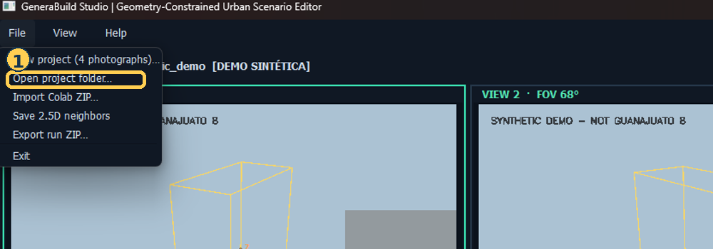
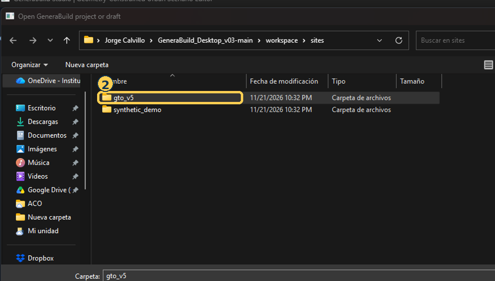
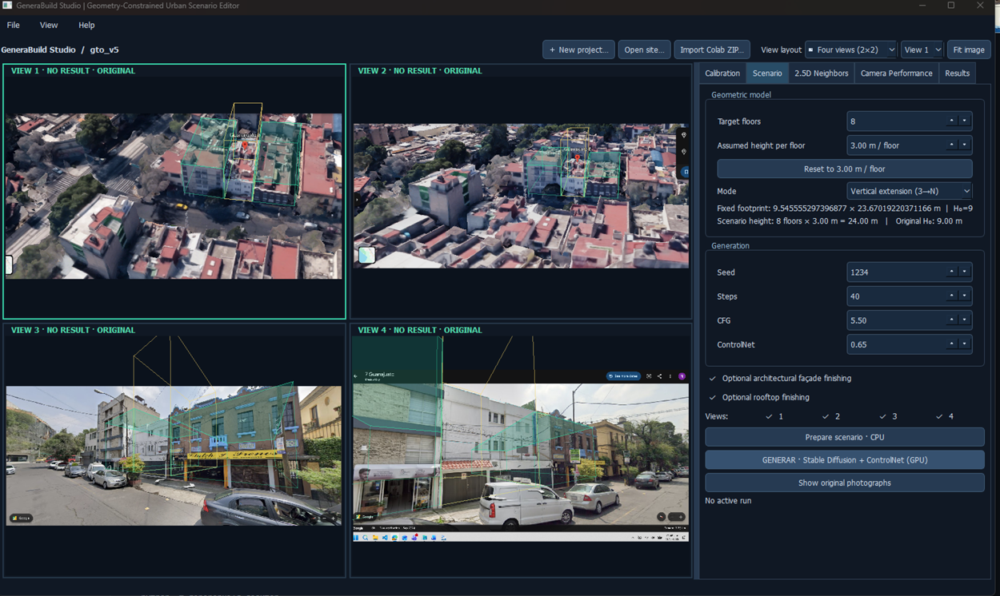
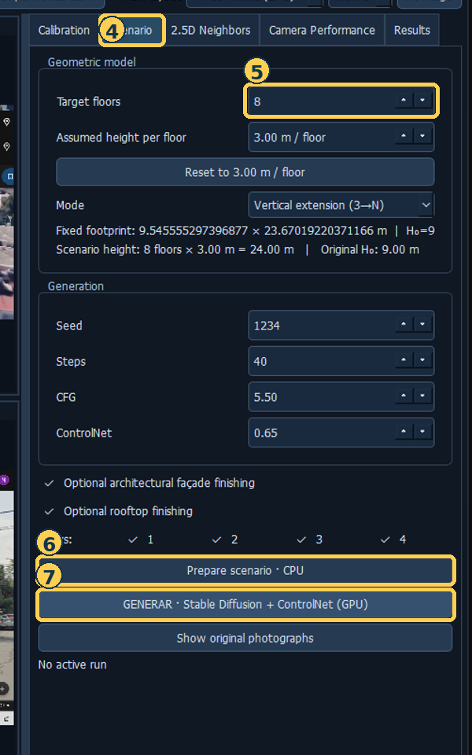

# Manual de usuario — GeneraBuild Studio

**Parte A | Escenarios de densificación vertical — Guanajuato 8, Roma Norte, Ciudad de México**

Este manual permite a una persona evaluadora **abrir el proyecto ya configurado y generar un escenario de 8, 9 o 10 niveles** sin volver a marcar las esquinas del edificio ni recalibrar las cuatro cámaras.

> **Nombre de la carpeta.** En las capturas de la aplicación el proyecto aparece como `gto_v5`. Si en la copia publicada se renombró a `gta8_v5`, seleccione este último. **No abra `synthetic_demo`**: contiene una demostración sintética y no las cuatro fotografías de Guanajuato 8.

## 1. Requisitos y lanzamiento

Se requiere Python con las dependencias declaradas en el repositorio. **Para sintetizar imágenes nuevas se necesita una GPU compatible y PyTorch con CUDA**, además de los paquetes de `requirements-gpu.txt`. Abrir el proyecto y consultar resultados ya guardados no exige generar imágenes nuevamente.

Desde la raíz del repositorio:

```bash
python3 -m venv .venv
source .venv/bin/activate
python -m pip install -r requirements.txt
# Para nuevas generaciones, instalar PyTorch con CUDA y después:
python -m pip install -r requirements-gpu.txt
python -m generabuild_desktop
```

Comprobación de GPU en Ubuntu:

```bash
nvidia-smi
python -c "import torch; print('CUDA disponible:', torch.cuda.is_available())"
```

Si la instalación no cuenta con CUDA funcional, la etapa de generación con Stable Diffusion no podrá completarse.

## 2. Abrir el proyecto Guanajuato 8

1. En la barra superior, seleccione **File → Open project folder...**; también puede usar el botón **Open site...**.
2. Navegue a `workspace/sites/`.
3. Seleccione la carpeta **`gto_v5`** (o **`gta8_v5`**, si es el nombre real en su copia) y pulse **Seleccionar carpeta**.
4. Verifique que el título superior cambie al nombre del proyecto y que se muestren **cuatro fotografías reales**, dos aéreas y dos a nivel de calle. No debe decir `synthetic_demo`.



*Figura 1. Menú File; la opción «Open project folder...» abre un proyecto existente.*



*Figura 2. Selección de la carpeta del sitio; la captura muestra el nombre `gto_v5`.*



*Figura 3. Proyecto cargado: cuatro fotografías y superposiciones geométricas. Las líneas y polígonos son ayudas de visualización, no la imagen generada.*

## 3. Configurar el escenario de altura

1. Abra la pestaña **Scenario** situada en el panel derecho.
2. En **Target floors**, indique **8, 9 o 10**. Se trata del **número total de niveles después de la intervención**, no del número de pisos por añadir.
3. Mantenga **Assumed height per floor = 3.00 m/floor** y **Mode = Vertical extension (3→N)**.
4. Compruebe que la aplicación muestre **Original H₀ = 9.00 m** y la altura nominal resultante.
5. Para reproducir el escenario mostrado en las capturas, conserve los parámetros de generación **Seed 1234, Steps 40, CFG 5.50 y ControlNet 0.65**.
6. Mantenga seleccionadas las **cuatro vistas (1, 2, 3 y 4)**. Las opciones **Optional architectural façade finishing** y **Optional rooftop finishing** pueden permanecer activadas para aplicar los acabados correspondientes.

| Target floors | Altura nominal total | Altura nominal añadida |
|---:|---:|---:|
| 8 | 24 m | 15 m |
| 9 | 27 m | 18 m |
| 10 | 30 m | 21 m |

*Estas alturas resultan del supuesto de 3 m por piso; no son mediciones certificadas del inmueble.*



*Figura 4. Panel Scenario. **4** identifica la pestaña; **5** el número de pisos; **6** la preparación geométrica (CPU) y **7** la generación (GPU).*

## 4. Generar el escenario

1. Pulse **Prepare scenario · CPU** para preparar la geometría, las máscaras y las guías del escenario con los parámetros seleccionados.
2. Pulse **GENERAR · Stable Diffusion + ControlNet (GPU)**.
3. Deje que termine la ejecución y revise la pestaña **Results**. Seleccione la ejecución generada y visualice las imágenes finales; puede usar **Four views (2×2)** o una sola vista ampliada desde la barra superior.
4. Para la entrega original se seleccionó como imagen principal la **Vista 2 del escenario de ocho pisos**. Si genera un escenario de nueve o diez pisos, documente ese número junto con la semilla y los demás parámetros.

**Nota importante.** Una semilla fija reduce la variabilidad, pero la igualdad píxel a píxel de una nueva síntesis puede depender de la GPU, del checkpoint descargado y de las versiones de PyTorch/Diffusers. Para cotejar la ejecución, conserve también los manifiestos, calibraciones, máscaras y resultados del proyecto.

## 5. Consultar resultados ya existentes

Si el repositorio incluye ejecuciones anteriores, no es necesario gastar GPU para verificar la demostración. Abra el proyecto y seleccione **Results** para examinar las corridas guardadas. Diferencie las imágenes **originales**, las previsualizaciones geométricas y el **resultado final generado**. El texto `NO RESULT · ORIGINAL` significa que en ese momento se visualiza la fotografía original y que no se ha seleccionado una ejecución activa.

## 6. Solución rápida de problemas

| Situación | Acción sugerida |
|---|---|
| Se muestra `synthetic_demo` | Abra **File → Open project folder...** y seleccione la carpeta del sitio real. |
| Error «Faltan dependencias GPU» | Active el entorno correcto, instale `requirements-gpu.txt`, compruebe CUDA y la instalación de PyTorch. |
| `CUDA disponible: False` | Instale una compilación de PyTorch compatible con la GPU y su sistema CUDA. |
| Aparece `NO RESULT · ORIGINAL` | Abra **Results** y seleccione una ejecución generada; o produzca una nueva. |
| Falta alguna de las cuatro fotografías | Confirme que está usando la carpeta completa del proyecto y no solo una copia de código. |
| Una nueva corrida difiere de la imagen archivada | Revise la semilla, altura, parámetros, versión del checkpoint y dependencias; no asuma identidad bit a bit. |

## 7. Criterios de comprobación para el evaluador

- [ ] Se abrió el proyecto real `gto_v5` / `gta8_v5`, no la demo sintética.
- [ ] Las cuatro fotografías y las geometrías calibradas son visibles.
- [ ] **Scenario → Target floors** contiene el número total de niveles deseado.
- [ ] Se conserva **Vertical extension (3→N)** y **3.00 m/floor**.
- [ ] Se usaron los parámetros documentados y las cuatro vistas, cuando corresponda.
- [ ] Se ejecutó **Prepare scenario · CPU** y, con GPU disponible, **GENERAR · Stable Diffusion + ControlNet (GPU)**.
- [ ] Se verificaron los resultados finales desde **Results**.

---

**Alcance:** GeneraBuild representa un escenario hipotético de incremento de altura mediante geometría 3D, cámaras calibradas, edición localizada y síntesis generativa. No certifica la altura física real ni la viabilidad normativa del inmueble. La nota técnica de la Parte A describe el condicionamiento, la preservación del contexto y las métricas geométricas propuestas.
